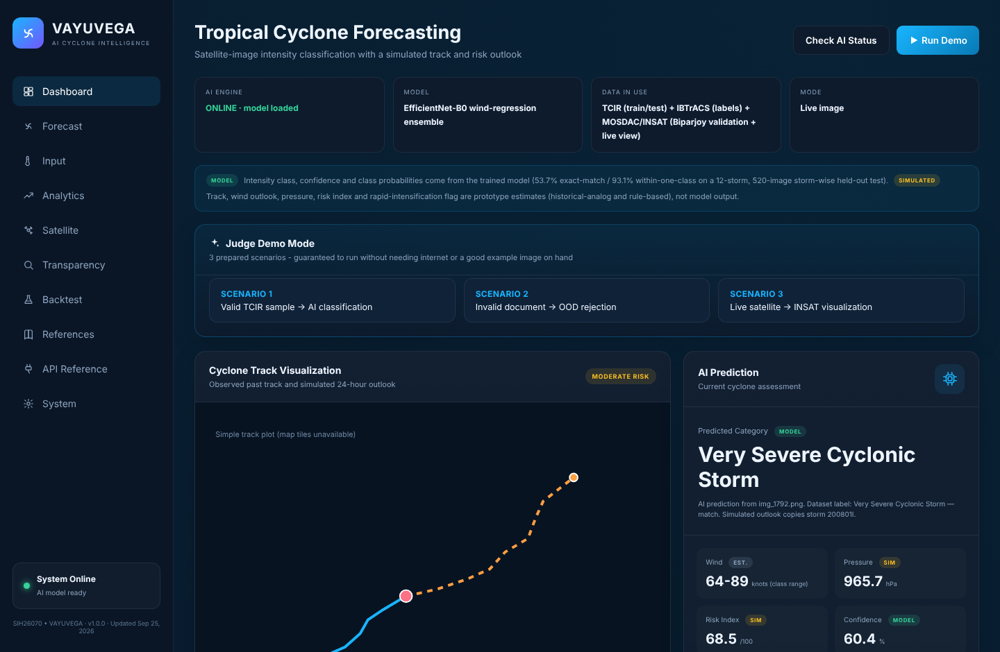
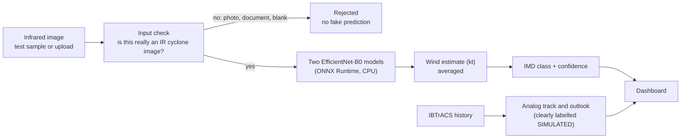

<picture>
  <source media="(prefers-color-scheme: dark)" srcset="docs/readme/banner-dark.svg">
  
</picture>


Forecasters judge a cyclone's strength partly by looking at its shape on an infrared satellite image: how tight the spiral is, how cold and deep the cloud tops are, whether there's an eye. PRISM-TC learns that from thousands of past storms. Give it one infrared image and it estimates the storm's maximum sustained wind and its IMD intensity class, and says how sure it is.

It was built by **team VAYUVEGA** for Smart India Hackathon 2026 (problem SIH26070). I was the model lead: I trained and evaluated the model and tracked down the preprocessing bugs that were quietly costing accuracy.



<sub>A real prediction from the running app: a test image from a storm the model never saw, classified as Very Severe Cyclonic Storm (correct). Every value is tagged MODEL, SIM or EST so nobody mistakes a simulation for a forecast.</sub>

## Results

Measured on **12 storms held out completely** from training (520 images), so the model can't just recognise storms it has seen before.

| | Result |
|---|---|
| Within one intensity class | **93.1%** |
| Exact class (5 classes) | 53.7% |
| Wind speed error (MAE) | 10.2 kt |
| Gap between training and test accuracy | 6 points (down from 42 in our first model) |

**On real Indian satellite data:** 36 INSAT-3DR frames of Cyclone Biparjoy (June 2023), downloaded from ISRO's MOSDAC portal and processed the same way as the training images. The model was within one class on all 36 and its average wind error was **4.9 kt**.

That's one storm, so it's a promising check rather than proof. The full, honest model card (including where the model is weak) is served by the app at `/api/model/transparency`.

### What changed between the first and final model

The first model scored 97% on its training storms and 55% on new ones. The cause was the data split: images from the same storm were landing in both training and test sets, so the test was too easy. Re-splitting by storm, switching to wind-speed regression, and averaging two models gave a model that is a little less flashy on paper and far more consistent on storms it has never seen.

## How it works



- **The model part is real:** intensity class, wind estimate, confidence and class probabilities.
- **The outlook is simulated:** the 24-hour track, pressure, risk index and rapid-intensification flag come from similar historical storms and simple rules, and the dashboard says so on every value.
- **It refuses bad input.** A classifier always returns *some* answer, even for a photo of an electricity bill. An input guard checks brightness, contrast and colour against real IR images and rejects anything that clearly isn't one.

## What's in the dashboard

- Upload an image or pick one of 10 test images, then get a prediction with class probabilities
- Model transparency panel with the accuracy, calibration and known failure modes
- Backtest mode that replays a historical storm and measures the track error
- Optional live INSAT-3D/3DS view from IMD, and real ERA5 sea-surface temperature, wind shear and humidity
- Optional Grad-CAM heatmap of what the model looked at
- A one-click demo mode and a printable report

## Run it

You need Python 3.10 or newer. No GPU and no PyTorch are needed: the trained models ship as ONNX files.

```bash
git clone https://github.com/binayakmandal-hash/PRISM-TC.git
cd PRISM-TC
pip install -r backend/requirements.txt
python backend/server.py
```

Open http://localhost:8000. The top-left status should say **ONLINE · model loaded**. Press **Run Demo**, or choose a sample image and press **Generate AI Prediction**.

Optional extras (live satellite view, ERA5 data) are switched on with environment variables; see `.env.example` and [backend/satellite/README.md](backend/satellite/README.md).

### Tests

```bash
python backend/tests/smoke_test.py
python backend/tests/smoke_test_features.py
python backend/tests/test_wind_math.py
```

They need no internet. `smoke_test.py --real` runs the checks against the real model.

## Project layout

```
PRISM-TC/
├── index.html · app.js · style.css   the dashboard (no build step)
├── backend/
│   ├── server.py          serves the dashboard and every /api route
│   ├── predict.py         loads the ONNX ensemble and runs a prediction
│   ├── ood_guard.py       rejects images that aren't IR cyclone images
│   ├── model_card.py      the numbers behind the transparency panel
│   ├── logic.py           IMD class rules, pressure, risk, analog track
│   ├── backtest.py        replay historical storms
│   ├── era5.py            optional ERA5 reanalysis fetch
│   ├── satellite/         optional live INSAT view from IMD
│   ├── samples/           10 test images
│   └── tests/
└── ROADMAP.md             where this could go next
```

## Limits we know about

- Trained on one infrared channel from the TCIR dataset. INSAT-3DR images have only been tested on one storm so far.
- Exact-class accuracy is modest; within-one-class is the more reliable number for a 5-class problem with fuzzy boundaries.
- The confidence comes from the wind estimate and the measured error, not from a softmax.
- Track and outlook are not machine-learning forecasts.

## Data and credits

- [TCIR](https://www.csie.ntu.edu.tw/~htlin/program/TCIR/) infrared cyclone images
- [IBTrACS](https://www.ncei.noaa.gov/products/international-best-track-archive) best-track labels
- INSAT-3DR data from ISRO's [MOSDAC](https://www.mosdac.gov.in) portal (access approved for this project)
- [ERA5](https://cds.climate.copernicus.eu) reanalysis from Copernicus
- Built by team VAYUVEGA, Asansol Engineering College, for Smart India Hackathon 2026

---

Model lead: [Binayak Mandal](https://github.com/binayakmandal-hash). Setup notes for Windows are in [README.txt](README.txt).
